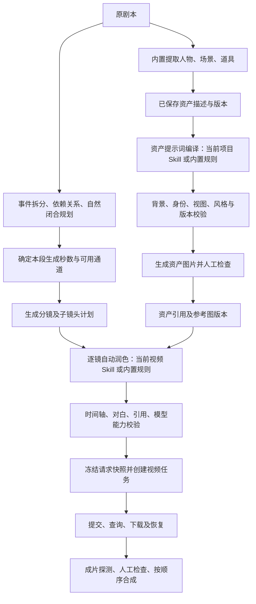

# 白同学短剧助手：资产 Skill 与 20 / 25 / 30 秒视频完整优化实施方案

> 方案版本：v1.0　｜　编制日期：2026-10-03  
> 源码基线：`1.3.0-preview.20261003`  
> 文档状态：历史实施设计；实际交付及未验收项以同目录 v1.4.0 实施验收报告为准。  
> 适用项目：`新版本/LocalMiniDrama-main`。本文中的源码路径均相对此目录。  
> 本文替代旧《30秒单段视频生成优化方案》中关于“第一、二阶段已完成”的进度口径；旧文保留为历史记录。

## 实施修订（2026-10-03，优先于下文原设计）

- P4 取消新增优化：保留原能力设置，用户设置 30 秒即信任，不增加能力验证门槛。第 7 节及 V-T04/05 中新增配置要求撤销。
- 用户已在 8790 生成 30 秒成功，登记为用户实测。
- 场景完整视图包默认正反左右一张 2×2 图；顶俯图可选默认关闭，替代原强制五视角两图及 A-T15 验收口径。
- 实际实现、验证和限制见 [v1.4.0 实施验收与使用说明](2026-10-03-v1.4.0实施验收与使用说明.md)。下文“尚未实现”等状态是设计时基线，不代表最新进度。

## 1. 交付目标与边界

完成两条主线，并解决它们交叉处的提示词、风格、模型能力和任务状态问题。

### 1.1 主线 A：资产提示词与 Skill 可靠接入

1. 人物、道具资产默认白底或规定的中性纯色底，所有人物面板遵守同一背景要求。
2. 画风只影响表现方式，不擅自添加人物、建筑、服装、武器、情节、背景或镜头。
3. 项目选择资产 Skill 后，人物、场景、道具图片提示词的自动与手动生成均经过对应规则。
4. 当前编辑内容、规则版本和实际提交内容可核对；复用旧提示词、调用失败、降级不能伪装成 Skill 成功。
5. 在既有资产入口中支持明确的视图策略，解决 Skill 与固定版式冲突。

### 1.2 主线 B：20 / 25 / 30 秒单段完整支持

1. 将段落容量、自然剧情时长、实际请求时长、成片测量时长分开管理。
2. 分镜按事件依赖与自然闭合规划，不为了固定镜数、固定秒数修改剧本。
3. 分镜、全能子镜头、视频 Skill、请求参数和实际协议使用同一个已校验时长。
4. 兼容 Seedance 2.5 的 4–30 秒范围通道，以及用户拟使用的 15 / 30 秒固定档位豆包管理工具。
5. 覆盖提交、排队、查询、下载、恢复、时长核验和最终合成。

### 1.3 必须保留的已有约定

- 故事梗概 → 故事/剧本：继续保留故事 Skill 独立入口，不在本次重写编剧规则。
- 从剧本提取人物、场景、道具：继续使用内置提取规则。
- 人物描述 → 人物图提示词、场景描述 → 场景图提示词、道具描述 → 道具图提示词：资产 Skill 的作用位置保持不变。
- 生成分镜 → 逐镜自动润色：视频 Skill 仍只在逐镜润色位置生效，不接管剧本改写或上游事件拆分。
- 不自动改写原剧本、原台词、人物身份、服装、关键道具、因果关系及原有节奏意图。
- 已有图片、视频、提示词和分镜不被批量覆盖；重新编译或重新规划产生可比较的新版本。
- 保留现有经典模式、首尾帧模式、全能模式；新增校验对所有提交入口统一生效。
- 不执行导入 Skill 包中的任意脚本，不自动安装其依赖，不把包内审批、声音资产或外部发布流程直接扩展成平台工作流。

### 1.4 本文不承诺的结果

提示词与程序校验能减少冲突，不能保证生成模型每次都准确还原站位、构图或时长。程序可验证结构、数值、引用和版本；叙事质量、视觉闭合和身份相似度仍需模型评估与人工检查。不得用“结构校验通过”表示“画面质量已通过”。

## 2. 当前实现核查：已实现、未实现与外部待验证

以下来自当前源码和本地数据库只读检查，不是功能完成清单。

### 2.1 资产主线

| 编号 | 当前事实 | 影响 | 处理阶段 |
| --- | --- | --- | --- |
| A01 | “东方玄幻”等风格预设含群山、楼阁、神像、前景刀刃、服装与固定构图 | 资产背景、造型和镜头受到无关内容干扰 | P1 |
| A02 | 人物提示词开头标注完整风格为最高优先级，结尾再次重复 | 与白底、身份和版式约束竞争 | P1 |
| A03 | 道具提交前会追加完整项目风格 | 编辑框已写纯色底，最终请求仍带场景词 | P1 |
| A04 | 道具规则同时要求唯一主体和“严格次要环境元素”；禁阴影与允许接触阴影并存 | 画面占比和背景表达冲突 | P1 |
| A05 | 道具提取已有 `image_prompt` 时，跳过 `generatePropPromptOnly` | 自动流程绕过所选资产 Skill | P2 |
| A06 | 人物/场景优先复用 `polished_prompt` / `polished_prompt_single` | 切换 Skill 或描述后可能继续使用旧结果 | P2 |
| A07 | 编辑 Skill 另存新包，不自动切换项目绑定；界面只编辑 `SKILL.md` | 用户以为修改生效，实际仍用旧包或其他文件的旧要求 | P2 |
| A08 | Skill 生效文件后追加完整“内置格式规则（必须遵守）” | 格式约束夹带内容与版式要求，限制 Skill 效果 | P2、P3 |
| A09 | 导入器只选部分目录；contracts、schemas、validators 等不在现有生效文本中 | “导入成功”不等于完整 Skill 工作流执行 | P2 |
| A10 | 资产 Skill 要求独立顶俯图＋正反左右四视图；平台要求一张全景/活动区/细节/角度变体四宫格 | 场景交付结构不一致 | P3 |
| A11 | 人物润色失败、部分场景生图临时润色失败后可退回原描述继续 | 图片成功不代表 Skill 编译成功 | P2 |
| A12 | 编辑框生成提示词主要提交 ID，后端读取数据库 | 尚未保存的修改没有进入本次编译 | P2 |
| A13 | 场景润色入口未传 `scene_image_polish` 路由键，人物/道具有对应路由键 | 专门配置的场景润色模型可能未被使用 | P2 |

当前数据库中，“测试”项目（父亲、女儿、缝包针）未绑定资产 Skill；“第八集 亲子鉴定”已绑定资产 v3.3.0。该事实仅描述检查时的配置，不能反推出每次历史生成的设置。

### 2.2 30 秒主线

| 编号 | 当前事实 | 尚需补齐 | 处理阶段 |
| --- | --- | --- | --- |
| V01 | 已有 20 / 25 / 30 秒选项及 `target` / `capacity` | 选项、规划容量和通道可生成秒数的语义需分开 | P4 |
| V02 | 已有 `settings.video_duration` 范围/固定档位配置 | 前后端能力重复，多模型配置未精确绑定能力 | P4 |
| V03 | Seedance 2.5 判断包含泛化的 `2[._-]5` | 可能误识别 Agnes 等其他 2.5 模型 | P4 |
| V04 | 可灵 Omni 保存分支独立；配置更新存在 `settings != null` 判断 | 时长配置可能漏存，清空覆盖配置可能失败 | P4 |
| V05 | 自动估算镜数按参数传入，后端追加“最高优先级指定镜数 ±10%” | 自动估算不应升级为用户硬约束 | P5 |
| V06 | capacity 已有自然闭合提示，但保存只限制 1～120 秒 | 20 / 25 / 30 秒上限缺少确定性执行校验 | P5 |
| V07 | target 保存会取 AI 时长与目标时长的较大值 | 不考虑事件内容的抬时长会使时间轴失真 | P5 |
| V08 | 尚无完整事件依赖、关键路径、不可切分节点和状态继承校验链 | 需要结构化规划及失败状态 | P5 |
| V09 | 全能子镜头归一化函数可按比例缩放各段时长 | 有可能压缩对白与必要反应；时长和相等不代表内容可演 | P6 |
| V10 | 路由创建任务后才校验请求秒数；非法/非正时长校验可放行 | 参数失败可能留孤立任务；需要严格校验 | P4、P6 |
| V11 | 视频执行时会用 `storyboards.duration` 覆盖任务请求时长 | 校验值与实际发送值可能不同 | P6 |
| V12 | 即梦、火山及其他适配器各自归一化或截断秒数 | 统一能力通过后仍可能被内部改秒数 | P6 |
| V13 | 豆包“测试连接”只访问根地址，非 401/403 就返回 | 联通不代表提交路径、协议和 30 秒能力可用 | P7 |
| V14 | 已有轮询恢复、下载和合成校验相关实现与测试 | 长排队、重启恢复、实际时长及混合段长合成须补充回归 | P7 |

Seedance 2.5 支持 4–30 秒以用户提供信息作为接入需求；每个管理器/中转通道的实际限制仍需单独验证。`127.0.0.1:8790` 是用户提供的 30 秒会员版管理器地址，不因此认定接口已经验收通过。

## 3. 总体流程：入口不变，增加编译记录与校验



所有“批量生成”“画布生成”“单镜生成”“图转视频”“重试”入口必须经过同一后端校验服务。前端校验提供反馈，后端校验决定是否创建任务。

## 4. 主线 A：风格与资产提示词规则

### 4.1 将现有风格描述拆成明确用途

为预设新增结构化字段，原 value 和已有资源路径不变：

| 字段（拟新增） | 内容 | 使用位置 |
| --- | --- | --- |
| `render_style_zh/en` | 媒介、写实程度、笔触、材质表现、色彩处理 | 人物、道具、场景、分镜与视频 |
| `character_render_zh/en` | 对人物适用的皮肤、发丝、服装材质表现 | 人物资产 |
| `prop_render_zh/en` | 对物体适用的材质、表面细节表现 | 道具资产 |
| `scene_render_zh/en` | 空间材质与环境表现方式 | 场景资产 |
| `reference_motifs` | 预览图中的群山、楼阁、神像、盔甲、刀刃等意象 | 展示与参考说明；默认不参与生产提示词 |
| `preset_revision` | 预设内容版本 | 变更检测与重编提示 |

不采用简单删除所有“背景”或“山”字的正则清洗：画框内部的海面、人物衣服上的山水纹样、剧情明确的武器属于合法主体信息。内容是否属于资产本体必须由字段来源和任务上下文判断。

所有已内置预设统一检查，不能只修东方玄幻或新加的 11 项。优先检查：具体环境、职业/性别、固定饰品、画面方向、镜头类型、景深和灯光。

自定义画风不自动改写。增加“生产画风”和“参考意象”分区；旧自定义整段描述先标记为未分类，在首次重编时给出拆分预览。用户手动编辑的既有提示词保持原文。

### 4.2 提示词优先关系

用统一约束对象管理优先关系，不继续在每段提示词中堆叠“最高优先级”：

1. 用户明确保存的事实与禁止修改项：人物身份、服装、道具形制、场景结构、剧本原文。
2. 当前任务与已选择视图模式的输出约定：人物/道具纯色底、视图数量、场景空间一致性。
3. 当前资产 Skill 中适用于该任务的生成规则。
4. 与任务兼容的渲染风格。
5. 默认光照、排版和质量修饰。

以上是冲突检测顺序，不允许平台偷偷把用户所选 Skill 的视图要求改成内置版式。若第 2、3 项不兼容，显示具体差异并要求选择兼容模式，编译状态为 `BLOCKED_REVIEW`。

对白、身份、内容和结构不是可通过“弱化提示词权重”消除的冲突；冲突必须在生成前解决。

### 4.3 人物资产默认规则

- 默认纯白底，所有人物面板一致，包括主脸特写、正面、背面和侧脸。
- 允许外层浅灰分隔线和技术标题栏；这些不属于人物面板的环境背景。
- 光照用于读清五官和服装；不添加灯笼、雾气、建筑、风景、剧情动作。
- 人物形体比例由已确认身份/美术方向决定；画风预设不得擅自改变年龄、性别、身份或服装。
- 正面与背面尺度统一，侧面类型由当前视图策略决定；不能同时要求“侧身全身”和“禁止侧身全身”。
- 原有工业参考表保持可选。Skill 要求的标准视图可作为独立模式，不强制迁移历史资产。

### 4.4 道具资产默认规则

- 道具是资产图的主要展示对象，与它在剧情里是否重要分开处理。
- 保留真实形制与比例；画面占比可放大用于看清细节，不能因此变成剧情里的巨型物体。
- 默认白底；白色、透明、银色道具可由用户选择中性浅灰/深灰背景。Skill 明确白底时不自动换色。
- 背景无环境、纹理、台面、额外物体；接触阴影政策明确为 `none` 或 `minimal_contact`，同次请求只能使用一种。
- 针线、剑鞘、画框内画面等按来源区分一体结构、套装组成、无关背景；“单一资产”不一律等于只有一个物理部件。
- 修改中文道具规则中的“严格次要环境元素”；保留真实比例约束。
- 中文任务和英文任务使用一致结构，修正用户提示强制英文而系统提示强制中文的冲突。

### 4.5 场景与下游引用

- 场景保持原地点、时代、空间关系、门窗、固定家具和天气时段，不从风格预设追加剧情未给出的建筑或人物。
- 场景四宫格/多视图是资产，不是视频分屏要求。传入视频时继续明确“只参考空间结构，单一完整画幅”。
- 人物参考只用于身份、服装、材质；道具参考只用于形制与材质；场景参考只用于空间与环境。
- 多视图文件应有机器可读的视图标签，不能只靠图片内文字识别含义。
- 资产替换后，下游显示引用版本变化。正在执行的任务使用原快照；新任务采用当前已选版本。

## 5. 主线 A：资产 Skill 执行与缓存治理

### 5.1 区分三种状态

界面分别显示：

- **已导入**：平台保存规则包。
- **项目已绑定**：本项目选择该规则包。
- **本次已使用**：本次提示词编译确实使用该包与版本，并通过校验。

仅“项目已绑定”不能证明既有图片由该 Skill 生成。历史提示词缺少记录时显示“来源未知/历史提示词”，不补造历史证明。

### 5.2 按任务编译规则，不拼接整个工作流

拟新增 `assetPromptCompiler.js`，输入至少包含：

```json
{
  "schema_version": 1,
  "drama_id": 4,
  "asset_type": "prop",
  "asset_id": 21,
  "description_revision": 3,
  "task": "prop_image_prompt",
  "view_policy": "single_asset",
  "background_policy": "white",
  "pack_id": "980af5d6b13ce6e3f2e86567",
  "pack_version": "3.3.0",
  "source_mode": "custom_skill",
  "language": "zh"
}
```

示例表示未来一次已绑定后的请求，不代表当前项目 4 已经选用该包。

规则提取分为三类：

| 类别 | 处理方式 |
| --- | --- |
| 图片提示词相关规则 | 加载白底、身份、视图、材质、空间连续性等；按人物/场景/道具分派 |
| 输入/输出 schema、校验清单 | 阅读并转为平台明确的字段和校验器；不把 JSON 文件机械塞入提示词冒充执行 |
| 声音、授权、注册发布、外部审批、任意脚本 | 不属于本次接入范围；兼容性面板明确列出 |

对资产 v3.3.0 提供专用适配配置，优先明确支持它的规则。其他导入包先生成兼容性报告：生效文件、未使用文件、缺失引用、不支持能力、冲突条款。缺少必要引用时阻止启用相关任务，不显示全部兼容。

禁止用静默截断绕过规则长度限制。超长规则先按任务裁剪无关模块，仍超出则明确报错。

### 5.3 自动提取后的统一处理

人物/场景/道具提取的实体和描述保持内置逻辑。提取阶段返回的图片提示词记录为 `extraction_draft`。

- 已选资产 Skill：即使提取已有图片提示词，也必须基于描述进入 Skill 编译；不把内置图片提示词当作最终成果直接跳过。
- 未选资产 Skill：使用内置编译器；可复用提取草稿，但仍需背景、风格、视图校验。
- 不重复执行剧本提取，不创建重复人物或道具。
- 异步编译保存时检查描述版本、绑定版本和当前任务号；旧请求不得覆盖后来的人工编辑。

### 5.4 手动编辑与重新生成

“根据当前描述生成提示词”提交编辑框当前内容和基础版本号；后端将其保存为描述修订，再编译对应快照。若后台版本已变化，返回 409 并显示差异。

“重新生成图片”默认使用当前明确选中的提示词版本。若输入、Skill 或风格已经变化：显示旧版来源及变化原因，允许“按当前规则重编”或“明确继续使用该人工/历史提示词”。不能自动覆盖人工文本。

场景单图与多视图分别管理缓存，不能互相复用；背景策略、视图模式变化同样使编译结果过期。

### 5.5 缓存键与溯源

提示词缓存至少覆盖：资产类型/ID、描述版本、输入事实摘要、Skill ID/内容摘要、渲染风格摘要、背景策略、视图策略、语言、编译器版本、文本模型路由配置版本。

现有表未提供足够字段。采用新增修订表保存完整记录，原 `polished_prompt` 等字段继续作为当前发布文本的兼容投影。

每条记录保存：

- 输入快照与原文摘要；Skill 生效文件清单及摘要。
- 采用内置还是自定义；模型、编译状态、降级原因。
- 文本模型输出、追加布局后的最终提示词、最终提交提示词摘要。
- 视图/背景策略、校验问题、创建时间、上一版本、是否人工编辑。

### 5.6 错误和降级策略

- 已明确选择自定义 Skill：失败时默认停在编译失败状态，不悄悄改用内置规则。
- 可提供“改用内置规则生成一个新版本”，由用户触发并记录来源。
- 内置规则编译失败同样显示原因；任何回退结果都标记 `fallback`，不能返回“Skill 编译成功”。
- 结构纠错最多 2 次，限定修复已有内容，不重新提取剧本；仍失败为 `BLOCKED_REVIEW`。
- 校验器检查明显环境冲突、必需视图、引用、身份字段与输出格式；视觉识别作为可选后验辅助，不宣称文本校验保证图片白底。
- 场景润色补齐 `scene_image_polish` 模型路由，与人物和道具一致。

### 5.7 Skill 编辑与启用体验

- 保存编辑后明确提示“已创建新版本，当前项目仍使用旧版本”。提供“用于当前项目”的独立动作。
- 编辑器增加文件列表，至少支持生效规则文件；展示该文件是否参与当前任务。
- 保存前校验路径、引用、文件大小、类型、语法及兼容性；ZIP 路径安全规则继续保留。
- 绑定新版本后仅标记相关资产提示词可能过期，不自动重画资产或重跑视频。
- 项目切换时重新加载绑定状态，取消旧页面请求；防止全局列表与项目绑定混淆。

## 6. 主线 A：多视图落地范围

### 6.1 视图模式

| 资产 | 保留的模式 | 增加的 Skill 兼容模式 |
| --- | --- | --- |
| 人物 | 当前工业参考表 | 标准 closeup/front/side/back，侧身类型明确；默认全部白底 |
| 场景 | 单图；全景/活动区/细节/角度变体四宫格 | 完整 `top90` 独立图＋front/back/left/right 四宫格 |
| 道具 | 单张资产主图 | 按等级/用户选择生成 front/side/top/detail，默认白底 |

等级不从短提示词猜测。资产 v3.3.0 的 S/A/B/C/G/X 如需影响视图数量，在面板中提供可确认字段；未确认时不自动跳过已有资产、删图或批量增加出图数量。

### 6.2 完整场景视图生产

1. 确认 front_axis、固定地标、空间结构和场景版本。
2. 编译顶俯图提示词与四个方向提示词。
3. 分别生成并记录逻辑视图。四方向采用独立面板生成后确定性合成为一张 2×2 图，标签由平台绘制，减少模型文字错误。
4. 五个逻辑视图校验通过后，发布两张基础交付图；中间面板保留用于局部重做。
5. 顶俯图失败仅重做顶俯图；某个方向失败仅重做该面并重新合成。空间结构整体不一致时才要求整体修订。
6. 原有 `image_url` 继续指向当前选择的代表图；新增文件表存完整视图包，不能把五个视图塞进一个字符串字段。

该模式需要多次图片生成，界面显示预计调用数及本次选中的视图；用户选择生成才提交。默认旧资产不切换到完整模式。

### 6.3 下游选图

视频参考图数量仍服从通道限制，不把所有面板自动塞入请求。使用已发布的代表图或合成图并附角色/场景/道具用途说明；数量超限时明确提示用户选择，不静默截断导致 `@图片N` 映射变化。

## 7. 主线 B：统一时长含义与模型能力

### 7.1 四种时间字段

内部以整数毫秒计算时间，序列化接口秒数由适配器按已声明精度转换。

| 字段（拟新增） | 示例 | 含义 |
| --- | --- | --- |
| `capacity_ms` | 30000 | 项目本次规划的单段容量上限 |
| `estimated_story_ms` | 25600 | 事件关键路径和自然闭合估计 |
| `request_duration_ms` | 26000 | 本次确定提交给通道的生成时长 |
| `actual_duration_ms` | 26080 | 下载后由 ffprobe 测得的媒体时长 |

`storyboards.duration` 在新规划中作为 `request_duration_ms / 1000` 的兼容投影；它不再用于覆盖已经创建任务的快照。不得把四种含义都写进同一个 duration 字段。

### 7.2 规划方式与旧数据

- `capacity`：“每段最多 X 秒”，推荐用于 20 / 25 / 30 秒；自然闭合可提前结束。
- `target`：“每段约 X 秒”，只是规划偏好，也必须遵守内容和能力上限。新规划器不再用 `Math.max(AI时长, 目标值)` 改写事实。
- 旧项目保持其原模式和已有分镜时长；新增 `planner_version` 区分旧规划与新规划。
- 老项目首次启用新规划器时展示行为变化，仅影响明确重新生成的分镜；不能后台全库修改。
- 视频提交的合法参数校验适用于新旧项目，不能借“兼容旧项目”继续提交超过接口能力的请求。

容量选项与请求秒数不是同一个下拉概念。例如通道仅支持 `[15,30]`，容量 20 秒可以规划可自然闭合于 15 秒的单元，但 18 秒的自然弧没有合法请求时长。界面提前解释限制，不把容量 20 秒误当成通道支持请求 20 秒。

### 7.3 能力来源与配置结构

保留 `settings.video_duration` 作为通道默认能力，增加按模型覆盖的 `video_duration_by_model`。示例：

```json
{
  "video_duration": {
    "mode": "range",
    "min_seconds": 4,
    "max_seconds": 30,
    "step_seconds": 1
  },
  "video_duration_by_model": {
    "seedance-2.5": {
      "mode": "range",
      "min_seconds": 4,
      "max_seconds": 30,
      "step_seconds": 1
    }
  }
}
```

固定档位示例：`{"video_duration":{"mode":"fixed","allowed_seconds":[15,30]}}`。

解析顺序：精确模型配置 → 通道配置 → 已知协议/精确模型注册表 → 兼容默认。另与适配器明确的技术边界求交集。区分“历史保守默认”与“已确认硬上限”，不能拿旧默认 15 秒抵消显式配置的 30 秒，也不能用用户配置覆盖已确认只有 12 秒的真实模型。

能力返回同时带 `source`、`verified_status`、`config_revision`、支持的生成模式及参数映射版本。用户声明可用于规划，但必须标注未实测；与真实接口反馈冲突时提示修正配置，不自动改请求秒数。

- Seedance 2.5 用精确别名表或明确配置识别；不得使用匹配所有“2.5”的宽泛正则。
- 自定义中转模型名允许显式配置，不能必须叫 Seedance 才支持 30 秒。
- 前端通过后端能力接口获取结果，移除独立复制的推断逻辑。
- 切模型/通道后重新检查待生成分镜；保留内容，不自动变更时长、模式或服务商。
- 删除覆盖能力时，只删除对应 key，保留其他 settings；API 必须区分字段未传、显式 null 和部分合并。
- 可灵 Omni、豆包、火山等配置共享能力保存逻辑，协议专用字段与时长字段合并保存。

### 7.4 数值校验

请求 duration 必须是有限、正数且满足通道精度；拒绝空字符串、NaN、无穷、负数、零和非法类型。范围检查、步长检查和固定档位检查使用未经偷偷四舍五入的原值。

缺少时长的旧入口可从已校验分镜中明确解析一次；解析失败返回字段错误，不直接默认为 5 秒提交。模型选择存在歧义时要求明确配置 ID。

能力示例：4～30、步长 1，允许请求 4、20、25、30，拒绝 3、31、29.7。规划估计 25.6 秒可在编译前向上量化为 26 秒；原始请求参数 25.6 不通过静默取整混入任务。

## 8. 主线 B：自然叙事弧与关键路径规划

### 8.1 单段基本约束

- 单段只允许 1 条主叙事弧，最多 2 个辅助模式。
- 18～25 秒自然闭合允许；26 秒的高质量闭合优于无功能拖到 29～30 秒。
- 不为了填满容量新增剧情、目标、冲突、攻击、反转或特效。
- 台词按原文保留；禁止通过异常加速对白硬塞时长。
- 总时长和镜数的自动估算仅用于预览与工作量提示，不进入硬约束。

### 8.2 区分自动估算和人工指定

生成请求新增：`storyboard_count_mode: auto|manual`、`total_duration_mode: estimate|manual_target`。自动值可作为 `planning_hint`，不得生成“用户要求恰好 N 镜”的指令。

人工指定镜数也不覆盖对白、因果和不可切分节点。若镜数与内容无法兼容，返回冲突及建议镜数，不删剧情凑数。保留用户的输入值作为待调整目标。

旧客户端无 mode 字段时，将未能证明为人工输入的数量按参考值处理并记录兼容来源；新版前端明确传递来源。

### 8.3 事件结构（拟新增）

每个最小事件至少包含：

| 字段 | 用途 |
| --- | --- |
| `event_id`、`source_span`、`source_quote` | 关联当前剧本版本及原文位置 |
| `type`、`participants`、`objects`、`location` | 发现、反应、决定、行动、对白、移动等 |
| `duration_min_ms`、`duration_estimate_ms`、`duration_max_ms` | 表演时长区间及估计依据 |
| `depends_on`、`parallel_group`、`resource_locks` | 顺序、可并行和冲突资源 |
| `indivisible_group` | 不可切分事件链 |
| `state_before`、`state_after` | 可继承的具体状态 |
| `dialogue_verbatim` | 逐字台词，保持说话人归属 |
| `closure_candidate`、`closure_evidence` | 叙事闭合与视觉闭合依据 |

事件顺序与原文事实保持对应；不把所有描述机械变成顺序耗时，也不把不同事件无依据地全部并行。对白和同一人物的高强度动作能否同时成立，需按实际表演能力检查。

### 8.4 七步拆分

1. 从已保存剧本版本拆出最小事件，并校验台词覆盖、事件来源与顺序。
2. 建立依赖图；禁止环、自依赖和不存在的事件引用。
3. 标记不可切分节点/事件组。
4. 找出候选闭合点，分别记录叙事与视觉证据。
5. 计算对白表演、人物动作、生活动作、战斗、特效、追逐移动、声音各轨道的关键路径。
6. 在容量内选择最后一个高质量双重闭合点；较晚但质量不达标的点不优先。
7. 生成段落、子镜头草案和结尾状态，经过校验后进入逐镜视频提示词润色。

模型负责语义提案，程序负责可确定的约束。闭合判断证据不足、时间区间跨越上限且无法收敛时进入 `BLOCKED_REVIEW`，不能以模型自评“通过”替代检查。

### 8.5 时间计算

对于有向无环依赖图：`start(event) = max(end(dependency))`，`end = start + duration`；根事件起点根据段落初始状态确定。并行动作取关键路径的最长持续时间，顺序阶段累加。

存在资源冲突时增加依赖：同一只手不能同时拿起两个不相容物体，同一人物不能同时出现在两个空间；物理不可能的并行不能缩短时长。

摄影机轨道在故事时间线确定后设计，并与动作并行。单纯运镜不额外增加剧情时间，必要的建立/反应/结果展示应已作为有意义的事件计入。

对白时长采用语言、正常语速、标点停顿、情绪和必要反应的可配置估算；默认基线必须通过样本校准并记录版本。不把语速作为超时后的自动调节器。若存在可用的同台词音频时长，可作为更可靠依据。

关键路径必须包含初始状态、独立反应或结果、最终视觉闭合。将估计区间与信心一并保存，不能假装文字估算能精确预测每一帧。

### 8.6 不可切分节点

- 核心对白未完成，或必要听者反应尚未成立。
- 信息已说出但关键听者尚未理解/反应。
- 决定已形成但没有可观察行动或可读的结果表现。
- 攻击未接触、防御、格挡、闪避或落空。
- 特效未完成接触与反馈。
- 道具交接未接收/明确拒绝，或争夺归属未定。
- 门已打开但门后结果未出现。
- 跨门/空间转折后没有稳定站位。
- 跨越障碍后未落地/恢复平衡。
- 跌倒后最终姿态未成立。
- 追逐转向后新路线未建立。

可用闭合点包括：完整台词＋听者反应、可观察的情绪决定、动作/战斗/特效结果、空间稳定站位、追逐阶段完成、证据取得、消息被理解、当前问题暂时解决。

### 8.7 超出容量的处理顺序

1. 并行化有真实依据且无资源冲突的事件。
2. 删除规划模型自行添加、无因果作用的冗余表达。
3. 删除无功能镜头安排。
4. 删除重复反馈。
5. 压缩非关键停顿，不压缩必要台词和表演。
6. 选择更早的双重闭合点。
7. 将完整事件/完整语义顺延到下一段。
8. 仍无法处理：`BLOCKED_REVIEW`，指出具体事件、最短可演时长和处理选项。

这里的“删除”只作用于生成的规划冗余，不删原剧本台词、关键事实、因果或节奏。单句完整语义已超过容量且没有合法切分点时必须阻止自动生成，不擅自改写台词。

### 8.8 空间连续性与结尾状态

| 类型 | 规则 |
| --- | --- |
| A_CONTINUOUS | 存在真实连续物理路径，容量允许时默认同段 |
| B_TRANSFER | 连续空间转移、目标一致，容量允许时保持同段 |
| C_NARRATIVE_JUMP | 叙事跳跃，默认新段；明示跳跃后的新初始状态 |

连续段的下一段第 0 秒明确继承：世界位置、身体朝向、视线、姿态、运动惯性、左右手状态、手持道具、武器、受伤、门窗、环境变化、特效残留、情绪张力、关键声音。

每个人物独立记录身体与手部状态；环境状态独立记录。禁止只写“同前/保持不变”。无法从原文推导时标记未知并提出确认，不编造受伤、武器或位置；不适用字段使用显式 `not_applicable` 及原因。

### 8.9 26 秒示例与容量变化

示意事件时长如下，仅展示算法，不作为所有剧本的固定节奏：

| 阶段 | 时间 | 并行关系 | 闭合说明 |
| --- | --- | --- | --- |
| 初始状态及发现证据 | 0–6 秒 | 视觉辨认与必要反应 | 尚未完成发送目标 |
| 截图并发送 | 6–12 秒 | 门外脚步声可从 8 秒进入 | 信息已发送，可形成候选阶段闭合 |
| 听见并理解威胁 | 12–15 秒 | 必要听觉/表情反应 | 威胁成立，但去门口行动未完成 |
| 走向门口 | 15–23 秒 | 脚步、呼吸、跟拍并行 | 移动中不能机械截断 |
| 到达门口并停稳 | 23–26 秒 | 结果展示与声音尾态 | 叙事、视觉双重闭合 |

- 容量 30 秒、范围通道：本段 26 秒，不新增后续剧情。
- 容量 25 秒或 20 秒：不能把 26 秒整体压缩到上限；重新检查 12 秒等更早候选点是否具备完整视觉反馈，再将余下自然弧放入下一段。
- 如果早期候选点实际不成立，标记需重规划；不能把“发送成功”几个字当作已拍到的反馈。

## 9. 时长量化、固定档位和全能模式

### 9.1 在润色前确定请求时长

从通道支持集合中选择不小于必要剧情时长、且不大于容量的最小时长。范围步长不是一律从 0 开始，按 `min + k × step` 计算。

向上量化新增的时间必须能由已有动作的自然收势、必要反应或结果展示承接；不允许硬加无意义静止。若估计时间短于通道最小时长且无合理延展，同样需重新组合或人工处理。

| 容量 | 自然剧情 | 通道 | 结果 |
| --- | --- | --- | --- |
| 20 秒 | 18.6 秒 | 4–30 秒、整数 | 19 秒，先明确 0.4 秒自然收尾 |
| 25 秒 | 23.2 秒 | 4–30 秒、整数 | 24 秒，先明确 0.8 秒自然收尾 |
| 30 秒 | 25.6 秒 | 4–30 秒、整数 | 26 秒 |
| 30 秒 | 26 秒 | 仅 15 / 30 秒 | 30 秒仅作为候选；必须确认已有事件可自然承接多出的 4 秒 |
| 25 秒 | 23 秒 | 仅 15 / 30 秒 | 无合法时长，重规划或换通道；不静默提交 30 秒 |
| 30 秒 | 31 秒 | 4–30 秒 | 更早闭合/顺延，不能截成 30 秒 |
| 30 秒 | 26 秒 | 最大 15 秒 | 规划前提示能力冲突，不能提交或压成 15 秒 |

固定 30 秒没有自然收尾方案时，不自动冻结末帧、不复制帧、不异常慢放，也不自动裁切后冒充原计划完成。选择灵活时长通道或重新分段是明确的解决路径。

### 9.2 全能模式含义

一条平台分镜记录对应一次视频 API 生成；其中 M 个子镜头属于同一视频时间轴，不会默认变成 M 次付费视频任务。

选择容量 30 秒、确定本段请求 26 秒后：

1. 根据事件计划形成可演的子镜头切分。
2. 子镜头时间区间覆盖 0～26 秒，禁止负时长、倒序、空洞或意外重叠。
3. 逐镜自动润色读取项目当前视频 Skill；未选则走内置规则。
4. 编译器保留原台词、事件来源、时间边界和资产引用，Skill 可优化表达但不能悄悄扩写剧情或改总秒数。
5. 通过校验后，最终提示词和请求参数一起冻结为 26 秒。

现有 M=1～8 的格式约束先保留为兼容范围；不强制“30 秒必定 6 镜/8 镜”。连续动作可以少切镜。某段超过当前支持的子镜头复杂度时，提示重新组织，不通过堆更多快切塞入内容。需要调整 M 上限时单独版本化格式规范和验证器。

### 9.3 修正时间轴归一化

审查 `universalSegmentDurationNormalize.js` 全部调用点。新规划器输出不得进入按比例缩放所有子镜头的旧逻辑。

- 微小序列化误差只允许在有余量的非对白收尾窗口内修正，并记录差异；修正后以整数毫秒精确闭合。
- 子镜头持续时间错误、遗漏对白、超时或重复编号，返回具体问题并重新编译，不改变台词速度。
- 自定义 Skill 输出需先解析为统一的时间轴中间结构，再渲染为其支持的文本格式。
- 格式无法可靠解析时显示“不支持该时间轴格式”，不显示已校验；人工文本可保存为草稿，但不能进入已验证自动生成路径。

### 9.4 四个一致性断言

提交前必须成立：

```text
已选择分镜计划的 request_duration_ms
    = 当前视频提示词时间轴结束毫秒
    = 视频任务快照 request_duration_ms
    = 协议请求字段换算后的毫秒数
```

同时满足：每条对白原文及说话人归属未改变；参考图映射与快照一致；当前计划没有未解决的 `BLOCKED_REVIEW`；通道能力允许请求值。

## 10. 视频提交、管理器适配和结果回收

### 10.1 冻结统一请求快照

拟新增 `videoSubmissionService.js`。顺序固定为：

1. 加载并验证项目、分镜、所选提示词与资产引用版本。
2. 解析具体视频配置 ID、精确模型、协议和能力版本。
3. 解析唯一的请求时长；显式参数与分镜计划不一致时返回 409，提示更新计划/提示词。
4. 编译最终请求正文，验证时间轴和适配器秒数。
5. 在同一数据库事务中创建任务、视频记录和快照。
6. 提交队列只消费快照，不重新读取正在变化的分镜 duration 或项目默认模型。

必须覆盖 `/videos`、图转视频、批量、画布、重新提交等入口。不要只修 `routes/videos.js` 的一个分支。

配置在排队中被删除或密钥更新时，任务可重新获取同一配置的授权信息，但端点/模型/能力等语义字段改变必须检测并暂停；不得把旧任务偷偷发到新端口。快照与日志不保存明文密钥。

### 10.2 协议适配器约束

- 适配器只负责映射字段、类型、单位和接口格式，不负责决定或改变剧情时长。
- 对 Seedance/豆包会员版适配，4～30 秒由实际能力合同决定。
- 不将所有协议中的 15 秒常量统一替换成 30；Veo、可灵、Agnes、MiniMax 等按自身能力回归。
- 遗留 clamp/归一化在请求非法时改为明确拒绝，或仅在规划阶段显式选择合法值；不能在网络提交前悄悄截断。
- 表单和 JSON 两种提交形式都验证最终字段值；字符串 `"30"` 与整数 `30` 按各接口合同输出。

### 10.3 豆包管理器诊断分层

| 检查 | 能证明什么 | 不能证明什么 |
| --- | --- | --- |
| 地址可连接 | 本地服务监听/网络连通 | 路径正确、30 秒可用 |
| 只读版本或能力接口（若管理器确有提供） | 工具版本、声明能力、协议版本 | 实际任务一定成功 |
| 提交格式检查/本地模拟服务 | 请求路径、字段、附件、秒数映射 | 下游真实账号或模型支持 |
| 真实样本任务 | 对应模式、时长、账号与通道组合可完成 | 所有模型与档位均已验收 |

当前地址使用 `http://127.0.0.1:8790` 作为会员版候选配置，旧 8787 或 15 秒工具可保留为独立配置；不要全局搜索替换端口。路径以工具实际协议为准，现有默认提交路径为 `/api/v1/video/generate`，查询使用当前管理器适配约定；不得猜造新的能力路径。

“测试连接”展示诊断层级。收到根路径 404 只表示 HTTP 服务有响应，不显示“30 秒生成可用”。收到 500 等错误保留状态及接口上下文，不当作成功。

### 10.4 任务状态与恢复

分开记录平台工作进程心跳、远端任务状态和下载进度：

```text
validated → submitting → remote_queued / remote_running
    → remote_succeeded → downloading → media_validating → completed
```

另设 `submission_unknown`、`recoverable_error`、`needs_review`、`failed`；与当前 task/status 字段通过映射兼容，先增加 phase，不一次性破坏所有旧状态消费者。

- 远端排队没有百分比变化，不等同于工作进程失联。
- 平台重启后，凭已持久化的远端任务 ID 和通道快照继续查询。
- 远端已完成但下载失败，保留结果地址与任务 ID，仅重试下载，不再次生成视频。
- 提交后网络中断、未拿到任务 ID：若管理器支持幂等键或客户端任务查询，按合同恢复；否则标记提交结果未知，禁止自动再次 POST 以免重复计费。
- POST 提交超时、单次查询超时、远端总等待期限和平台心跳期限分别配置；视频长度 30 秒不等于生成等待 30 秒。
- 到达总等待期限显示可恢复状态与“继续查询”，不直接认定远端失败。
- 轮询退避有上限，取消操作明确是否仅停止本地查询或确实取消远端任务。

### 10.5 实际媒体时长与合成

- 下载后 ffprobe 检查音视频流、实际时长、分辨率及容器；保持已有完整解码验证。
- 默认 ±0.3 秒是实际媒体与本次请求的核验提示阈值，不能扩大请求上限，也不要求自然弧贴近 30 秒。
- 超阈值保存成片并标记差异，不自动重生成、丢弃或修改原计划。音视频流末尾差异单独记录。
- 合成按选中版本、镜序和实际媒体时长处理；15 / 20 / 25 / 26 / 30 秒可混用，不按项目默认段长统一裁切/补帧。
- 合成总时长与输出文件实测时长核对；编码、分辨率、帧率不兼容时明确转码策略，不能盲目 `-c copy` 后直接报成功。
- 自动变速、插帧、重复尾帧、裁掉对白都不属于默认补时策略。需要剪辑时使用独立、明确的人工操作。

## 11. 数据与接口设计（均为拟新增/拟调整）

### 11.1 数据演进

采用增量迁移，保留原表与字段，不重建用户数据库。

| 存储 | 关键字段/职责 |
| --- | --- |
| `asset_prompt_revisions`（新表） | 资产类型/ID、输入版本、Skill 摘要、风格/视图策略、编译状态、草稿/最终文本、校验报告、人工标记、父版本 |
| `asset_files`（新表） | 资产版本、视图类型、文件路径、媒体信息、校验/发布状态、生成记录 ID |
| `episode_planning_runs`（新表） | 剧本版本、规划模式、容量、模型能力快照、事件图、计划 JSON、状态、校验问题 |
| `storyboard_plan_links`（新表） | 分镜 ID、规划 run/revision、段落键、时长四字段中的规划字段、前后状态、子镜头结构 |
| `video_request_snapshots`（新表） | 视频记录 ID、配置 ID/版本、协议、模型、最终提示词/引用摘要、请求时长、幂等键、响应任务 ID、实际时长 |
| `creative_skill_settings`（增量字段） | 绑定 revision、绑定时间，用于并发检查 |
| `dramas.metadata`（增量字段） | planner_version、计数/总时长来源、风格 revision、迁移状态 |

实际 DDL 编写前检查 `migrate.js` 和现有字段；以上新表名在实现前统一定稿，避免与现有结构重复。

### 11.2 状态约定

资产编译状态：`draft / compiling / ready / stale / blocked_review / failed`。手工文本以 `source_mode: manual` 区分来源，不伪装成 Skill 编译结果。

规划状态：`draft / planning / validated / blocked_review / failed / superseded`。只将 validated 的选定版本发布到现有分镜；模型流式内容先保存在规划草稿，不能先覆盖旧分镜再发现超时。

错误码至少覆盖：

`SKILL_NOT_BOUND`、`SKILL_INCOMPATIBLE`、`PROMPT_STALE`、`ASSET_REVISION_CONFLICT`、`STYLE_CONTENT_CONFLICT`、`VIEW_POLICY_CONFLICT`、`INVALID_DURATION`、`DURATION_CAPABILITY_MISMATCH`、`TIMELINE_MISMATCH`、`DIALOGUE_CHANGED`、`NO_VALID_CLOSURE`、`SUBMISSION_UNKNOWN`。

未选自定义 Skill 时正常走内置，不报 `SKILL_NOT_BOUND`；该错误仅用于请求明确要求某自定义包、实际却未绑定/不一致的情况。

### 11.3 API 变更

保留现有路由，扩展返回值，新增公共服务接口。下列路径均为设计，不是当前可调用接口：

| 接口 | 设计用途 |
| --- | --- |
| `GET /api/v1/video-capabilities?config_id=&model=&mode=` | 后端统一解析可用能力，不返回密钥 |
| `POST /api/v1/assets/:type/:id/prompt-preview` | 对当前编辑输入编译草稿，携带 base_revision |
| `POST /api/v1/assets/:type/:id/prompt-revisions/:revision/publish` | 选择可用提示词版本，更新兼容字段 |
| `GET /api/v1/assets/:type/:id/prompt-revisions` | 来源、历史、差异和校验问题 |
| 现有 `generate-prompt` 路由 | 转调统一编译服务，接受当前描述和 base_revision，兼容旧调用 |
| 现有生成分镜路由 | 增加 count_mode、duration_mode、planner_version，返回 planning_run_id |
| 现有视频提交路由 | 接收 config_id、prompt_revision、plan_revision、idempotency_key，统一校验后创建 |

400 用于非法参数，409 用于版本/配置冲突，422 用于语义或结构无法满足，异步已受理返回 202 或兼容现有创建响应。前端显示具体字段与修复动作，不把所有失败合并成“接口不支持”。

### 11.4 并发与事务

- 编译、规划、提交都绑定输入 revision；旧异步结果不得覆盖新输入。
- 同一输入快照重复点击按幂等键复用任务；用户明确“再次生成”创建新 attempt，不被永久去重。
- 先校验后写任务；任务、视频记录、快照事务内一起成功或回滚。
- 长模型调用不占数据库事务；先记录 draft，完成后短事务发布。
- 导入或迁移中断可重跑，新增字段/索引均做存在性检查。

## 12. 实施顺序、改动位置与阶段出口

按下表顺序执行。资产链路和视频链路可以在分支上分别开发，但发布前必须汇合回归；本方案不要求自动启动多个代理。

| 阶段 | 主要工作 | 主要现有文件 | 该阶段完成标准 |
| --- | --- | --- | --- |
| P0 基线与备份 | 工作目录快照、SQLite 一致性备份、现有测试、记录真实端口和配置引用 | VERSION、migrate.js、现有 test | 可恢复；记录失败基线，不覆盖用户工作 |
| P1 规则冲突治理 | 风格分用途、白底/纯色底、道具主体/阴影、全链路注入复核 | generationStylePresets.js、styleOptions.js、dramaStyleMerge.js、promptI18n.js、characterLibraryService.js、sceneService.js、propImageGenerationService.js、framePromptService.js、imageService.js、routes/videos.js | 人物/道具最终提示词无无依据场景；原事实和布局保留 |
| P2 Skill 可靠执行 | 统一编译器、修复道具绕过、来源/缓存/版本、编辑输入、错误和绑定体验 | creativeSkillPacks.js、propExtractionService.js、characterGenerationService.js、backgroundExtractionService.js、propService.js、sceneService.js、RuleSkillManager.vue、三个 useAssets 对应 composable | 选 Skill 的三类任务均有可核对编译记录；旧结果不误报新规则已用 |
| P3 视图兼容 | 视图策略、场景两文件包、局部重做、文件版本与下游选图 | sceneService.js、characterLibraryService.js、propImageGenerationService.js、useScenes.js、useCharacters.js、useProps.js、资产预览组件 | v3.3.0 支持范围可见；标准多视图与现有模式均可用 |
| P4 模型能力 | 已按用户决定取消优化 | 保留原有 UI 与设置 | 用户声明 30 秒即信任；请求一致性检查归入 P6 |
| P5 叙事规划 | 事件图、关键路径、闭合点、状态继承、计数来源、草稿发布 | episodeStoryboardService.js、promptI18n.js、FilmCreate.vue、storyboards 路由 | 20/25/30 容量与原台词通过程序校验；无法满足时可解释阻止 |
| P6 提示词与请求一致 | 视频 Skill 位置保留、时间轴校验、取消机械缩放、冻结提交快照 | customVideoPrompt.js、universalPromptPolish.js、universalSegmentPromptBundle.js、universalSegmentDurationNormalize.js、videoService.js、videoClient.js、视频及图转视频路由、画布批量入口 | 计划/提示词/任务/实际请求秒数一致；无孤立任务与静默截断 |
| P7 管理器与媒体验收 | 诊断分层、8790 合同核对、排队重启恢复、下载重试、实际时长与混合合成 | aiConfigService.js、videoClient.js、videoService.js、taskService.js、videoMergeService.js、utils/videoMedia.js | 模拟异常全过；已配置真实通道的声明能力逐项验证 |
| P8 发布交付 | 旧数据迁移预览、全入口回归、文档、版本、源码包与校验清单 | docs、CHANGELOG、VERSION、package/lock、交付脚本 | 验收矩阵逐项签收；未验证项明确；可回退 |

拟新增服务可按实际规模合并为：`assetPromptCompiler`、`assetPromptValidation`、`videoCapabilityService`、`narrativeUnitPlanner`、`videoSubmissionService`。不要为了文档逐项创建大量空壳模块；职责清晰、单一事实来源是验收依据。

建议 P1～P2 先交付一个资产可靠性预览版本，P4～P6 再交付长时长预览版本，P3/P7 完成后整体验收。预览版本按发布日期和当日序号递增，例如在当前基线上增加 `1.3.0-preview.20261003.1`、`1.3.0-preview.20261003.2`；实际交付时使用实际日期，保证语义版本排序递增。最终稳定版本号在实际发布时确定，不提前把状态写成正式完成。

每阶段记录：已修改文件、验证证据、未完成项、数据变更、回退点和下一阶段入口。某阶段失败先修该阶段，不能靠下一阶段补一句提示词掩盖。

## 13. 测试与验收矩阵

### 13.1 资产与规则

| ID | 场景 | 必须观察到的结果 |
| --- | --- | --- |
| A-T01 | 东方玄幻＋父亲/女儿资产 | 提交文本包含同一白底策略，无无依据群山/神像/建筑 |
| A-T02 | 东方玄幻＋缝包针 | 针为资产展示主体，保留针线形制，无环境场景追加 |
| A-T03 | 赛博/武侠预设＋普通人物 | 不自动新增面罩、机械盔甲、刀刃或伤疤 |
| A-T04 | 场景使用同一风格 | 保留实际地点结构，不改成预设缩略图里的地点 |
| A-T05 | 道具本身是山水画/有花纹 | 不误删资产本体中的合法场景或纹样 |
| A-T06 | 已选 Skill，提取道具已有 image_prompt | 仍进入 Skill 编译；提取草稿和最终版本可区分 |
| A-T07 | 无 Skill | 使用内置编译器并标明来源，正常生成 |
| A-T08 | 切换 Skill 后重新生图 | 旧提示词标 stale；重编/保留原版有明确选择 |
| A-T09 | 编辑 Skill 保存 | 新包、原绑定、切换动作分别可见；不会自动改所有项目 |
| A-T10 | 修改描述未保存就编译 | 本次编译使用当前编辑内容；冲突时返回 409 |
| A-T11 | 编译中继续编辑或切包 | 旧编译结果不能覆盖新内容 |
| A-T12 | 自定义 Skill 模型调用失败 | 不显示 Skill 成功；不静默回退内置 |
| A-T13 | 缺引用/超长/不支持的 Skill | 导入兼容性报告说明具体文件和能力 |
| A-T14 | 场景单图与多视图来回切换 | 不互用缓存，不把四宫格提示用于单图 |
| A-T15 | Skill 场景完整视图 | 五逻辑视图、两交付文件、固定方向轴、同一版本 |
| A-T16 | 某一个视图失败 | 只重做失败视图，保留通过结果 |
| A-T17 | 专门配置场景润色模型 | 请求实际走 scene_image_polish 路由 |
| A-T18 | 手工修改提示词 | 原文保留、标记 manual；规则更新不自动覆盖 |

### 13.2 时长与叙事规划

| ID | 场景 | 必须观察到的结果 |
| --- | --- | --- |
| V-T01 | 4～30 范围能力 | 4/15/20/25/30 合法，3/31/29.7 等非法请求明确拒绝 |
| V-T02 | 固定 15/30 | 仅合法档位；20/25 容量下不能暗中提交 30 |
| V-T03 | Agnes 2.5 等非 Seedance 模型 | 不被名称中的 2.5 识别为 30 秒 Seedance |
| V-T04 | 多模型同一配置 | 切模型后能力随精确模型变化 |
| V-T05 | 可灵 Omni 保存范围/固定/恢复默认 | AK/SK 等其他 settings 保留；覆盖能力可清空 |
| V-T06 | 30 容量＋26 秒自然弧 | 保存 26 秒，不填充新剧情 |
| V-T07 | 25 容量＋26 秒不可切事件 | 不压成 25，返回重规划/阻止原因 |
| V-T08 | 完整对白超容量 | 原台词不变，不异常加速，必要时 BLOCKED_REVIEW |
| V-T09 | 自动估算约 N 镜 | 允许自然闭合产生不同镜数，无恰好 N 镜硬约束 |
| V-T10 | 人工镜数与对白冲突 | 说明冲突，不删对白或关键反应 |
| V-T11 | 并行轨 8 秒和 5 秒、后续 4 秒 | 无其他依赖时关键路径为 12 秒，不误算为 17 秒 |
| V-T12 | 同人物同手的冲突动作 | 不允许不可能的并行压时 |
| V-T13 | 环/缺失依赖/重复事件 | 确定性校验失败，不继续发布 |
| V-T14 | 台词原文变化/遗漏/说话人错配 | 阻止发布并定位 source_span |
| V-T15 | A/B 连续空间与 C 叙事跳跃 | 分段处理符合规则，下一段初始状态明确 |
| V-T16 | 段尾只写“同前” | 校验失败；不适用状态需显式表达 |
| V-T17 | 全能 26 秒多子镜头 | 时间轴 0～26，完整台词/动作可演，不按比例硬缩 |
| V-T18 | 选视频 Skill | 仍在逐镜润色调用，不移动到拆剧本阶段 |

### 13.3 提交、恢复与媒体

| ID | 场景 | 必须观察到的结果 |
| --- | --- | --- |
| J-T01 | duration 为 0/负值/空白/NaN/非法类型 | 返回错误，数据库无新增孤立任务 |
| J-T02 | 提交时长与分镜不同 | 409/422，指出计划或提示词待更新，不偷偷覆盖 |
| J-T03 | 任务排队后分镜/项目配置变化 | 仍使用被冻结的合法快照或明确暂停 |
| J-T04 | 同一按钮重复点击 | 不重复提交同一任务；明确再次生成可产生新 attempt |
| J-T05 | 即梦 JSON / multipart、火山、豆包 | 最终请求字段与校验秒数一致；非法值不 clamp |
| J-T06 | 单镜/批量/画布/图转视频 | 全部走同一提交服务，无旁路 |
| J-T07 | 根地址 404 | 显示联通层级，不显示 30 秒能力已验证 |
| J-T08 | 8790 接口仍返回“仅 4～15 秒” | 保留远端原始错误，定位通道/版本冲突，不改成 15 秒重发 |
| J-T09 | 长排队无进度百分比 | 按远端状态继续跟踪，不误判本地任务僵死 |
| J-T10 | 提交后掉线且无任务 ID | 标 submission_unknown，不自动二次付费提交 |
| J-T11 | 平台重启 | 已有远端任务按原配置继续查询，无重复提交 |
| J-T12 | 远端成功、下载失败 | 可单独重试下载并补回传 |
| J-T13 | 请求 26 秒、实际偏差超过 0.3 秒 | 成片保留、显示差异，不自动丢弃或重生成 |
| J-T14 | 15/20/25/26/30 秒混合合成 | 顺序正确、可播放、实际总时长合理、对白未截断 |
| J-T15 | 过期 URL / HTML 假视频 / 缺视频流 | 不标完成；区分下载与媒体校验失败 |
| J-T16 | 参考图超限或引用版本变化 | 不静默丢图，时间轴与 @图片N 映射保持一致 |

### 13.4 验证方法与发布门槛

1. 纯函数测试：能力解析、数值校验、事件图/关键路径、时间轴、规则分派和摘要计算。
2. 本地假模型/假管理器：抓取真实路由生成的请求，验证 JSON/multipart、任务事务、轮询、超时与恢复；不依赖模型付费生成。
3. 临时 SQLite 集成测试：模拟切换 Skill、异步写冲突、旧数据迁移和 task/video 原子创建。
4. 浏览器真实入口：编辑描述、绑定/编辑 Skill、切模式、批量/画布提交、错误呈现与结果回收。
5. 真实图片样本：人物、道具、场景分别验收；背景、身份、布局由人检查，记录失败样本，不仅看提示词文字。
6. 真实视频样本：对声明支持的 20/25/30 秒范围档分别验证；再验证自然闭合 26 秒及固定 15/30 通道。固定通道不要求通过其不支持的 20/25 秒请求。
7. 回归已有 4～15 秒项目、已保存人工提示词、经典/首尾帧/全能模式、下载与合成。

现有后端 98 项、前端 19 项测试及构建通过，只是 2026-10-03 源码交付基线，不等于本文新增矩阵已通过。未来每次发布附当前实际命令、结果、样本记录和未验证项。

稳定版最低条件：所有适用自动化验收通过；至少完成主用通道的真实闭环；不支持的能力在 UI 明确禁用或标注未验收。未具备真实通道条件时只发布预览版，不写“全链路完成”。

## 14. 旧数据、回滚与发布

### 14.1 迁移原则

- 使用 SQLite 在线备份接口或停服务后的完整备份，不在活跃 WAL 状态下只复制单个 `.db` 文件。
- 先生成迁移影响预览：哪些项目有旧风格文本、哪些提示词来源未知、哪些分镜超能力、哪些任务仍在执行。
- 旧 `metadata.style_prompt_zh/en` 可能固化有问题的完整预设；修改预设定义不会更新这些值。预置风格且未人工改写的项目可提供“更新到新版预设”的显式操作，自定义风格保持人工确认。
- 既有提示词保留并标记 legacy/unknown，不伪造 Skill 使用记录，不自动批量重编或付费重生成。
- 旧任务缺少快照时按其已保存远端任务信息恢复，只查询，不依赖当前默认配置重新提交。
- 已有分镜不在后台自动换成 30 秒；需要用户选择目标剧集重新规划并比较差异。

### 14.2 分阶段回退

- 每阶段保留源码版本与配置快照，新增表优先向后兼容。
- 通过功能开关回退新规划器/新编译入口，保留新数据供排查；旧服务未兼容的新任务不能交给旧 worker 继续发起生成。
- 回退前停止接收新任务并处理在途任务，记录外部任务 ID，避免失去回收能力。
- 不为回退删除新图片、视频或重置资产版本；选择上一已发布提示词/计划版本即可恢复业务引用。
- 全库数据库恢复只用于明确的数据恢复场景，不能当作普通源码回退，以免抹掉用户最新创作。

### 14.3 最终交付物

- 版本化源码 ZIP、VERSION、CHANGELOG、逐文件 SHA-256 清单。
- 数据迁移说明、备份/回退步骤、启动说明。
- 资产 Skill 支持范围与生效路径说明。
- 人物/场景/道具最终提交提示词预览及来源面板。
- 20/25/30 秒使用说明、模型能力配置示例、固定档位说明。
- 8790 管理器接入合同与诊断结果，真实验证过的组合清单。
- 验收矩阵结果、失败样本、未完成项，不以“能选 30 秒”替代全流程验收。

## 15. 首轮实施的明确任务清单

首轮从 P0、P1、P2 开始，避免同时重写所有生成逻辑：

- [ ] 核对当前工作目录、运行进程、数据库路径并备份。
- [ ] 为现有风格预设拆出资产适用的渲染字段，补齐旧预设回归样本。
- [ ] 统一人物/道具背景、主体占比与阴影规则，取消冲突描述。
- [ ] 道具提取后明确进入所选 Skill 编译。
- [ ] 增加最小可用的提示词来源/版本记录和 stale 检测。
- [ ] 修复编辑描述未提交、Skill 保存未切换的交互反馈。
- [ ] 自定义 Skill 失败明确报错，禁止未标注回退。
- [ ] 验证父亲、女儿、缝包针三个实际案例与“亲子鉴定”已绑定 Skill 项目。
- [ ] 验收通过后进入 P3～P7，完成多视图和 30 秒链路。

后续执行以每阶段出口标准为准。资产默认规则修复完成、30 秒能力配置完成、自然闭合规划完成、真实通道闭环完成应分别记录，不能合并成一句“已全部支持”。

## 16. 源码依据索引

以下均为本方案核对过的现有文件；上述拟新增模块、表、API 尚未实现。

- `frontweb/src/constants/styleOptions.js`、`backend-node/src/constants/generationStylePresets.js`：预设画风文本。
- `backend-node/src/utils/dramaStyleMerge.js`：项目 metadata 优先于预设定义的风格合并。
- `backend-node/src/services/creativeSkillPacks.js`：文件筛选、项目绑定、Skill 与内置规则拼接。
- `frontweb/src/components/RuleSkillManager.vue`：导入、编辑另存、项目绑定。
- `backend-node/src/services/characterLibraryService.js`：人物提示词缓存、拼接与降级。
- `backend-node/src/services/sceneService.js`：场景单图/四视图提示词、缓存与模型调用。
- `backend-node/src/services/propExtractionService.js`、`propService.js`、`propImageGenerationService.js`：道具提取、编译及追加风格。
- `backend-node/src/services/promptI18n.js`：资产、分镜、全能及道具内置规则。
- `frontweb/src/composables/filmCreate/useCharacters.js`、`useScenes.js`、`useProps.js`：当前描述编辑与生成入口。
- `frontweb/src/views/FilmCreate.vue`：时长选项、估算镜数、项目元数据与视频提交。
- `frontweb/src/components/AIConfigContent.vue`、`backend-node/src/services/aiConfigService.js`：能力 settings 保存和连接测试。
- `backend-node/src/services/episodeStoryboardService.js`：分镜约束、时长保存及自动润色连接。
- `backend-node/src/services/customVideoPrompt.js`、`universalPromptPolish.js`、`universalSegmentPromptBundle.js`、`universalSegmentDurationNormalize.js`：视频 Skill、时间轴和子镜头归一化。
- `backend-node/src/routes/videos.js`、`backend-node/src/services/videoService.js`、`backend-node/src/services/videoClient.js`：任务创建、时长覆盖、通道校验、管理器请求。
- `backend-node/src/services/taskService.js`、`videoMergeService.js`：任务管理及合成。
- `backend-node/resources/creative-skills/visual-asset-skill-3.3.0.zip` 和数据库中已导入的同版本规则包：资产 Skill 视图与生产要求。包内文本作为被分析规则，不作为本轮操作授权。

本方案仅完成设计与文档交付。本轮没有修改生成代码、数据库绑定、任务状态或原有素材。
