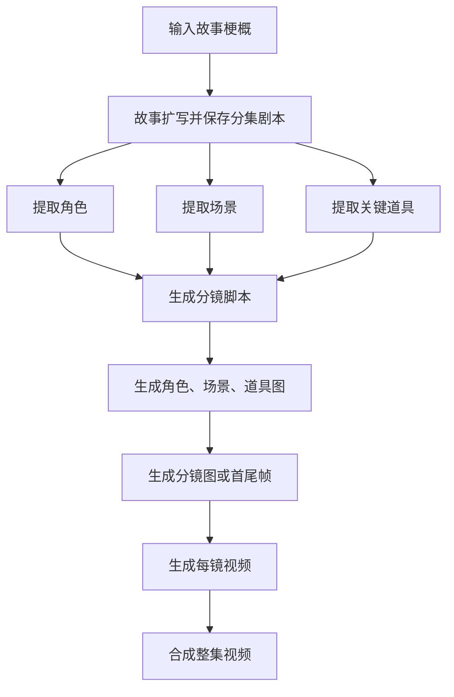

# 生成规则与流程

本文依据当前版本的前端流程、后端服务和提示词整理，说明 LocalMiniDrama 从故事输入到整集视频的生成逻辑。用户可在制作页手动分步生成，也可使用“一键全流程”或“补全并生成”。

## 一、整体流程

流程不是一个不可分割的模型调用：文本模型负责扩写、提取与分镜；图片模型负责角色/场景/道具/分镜静帧；视频模型按分镜生成片段；后端再把视频片段合成为整集。任务在后台异步执行，前端轮询任务状态和刷新生成结果。

## 二、从梗概到剧本

故事扩写是独立于“一键成片”的步骤。用户输入故事梗概，可附带故事风格、剧本类型和集数；文本模型按提示词生成剧本，并保存到剧集的分集记录中。

默认规则：

- 中文项目要求中文剧本；每集约 800 字，多集剧情前后衔接，每集有起承转合并在结尾留下悬念或转折。
- 返回值要求为纯 JSON 数组，每集包含 `episode`、`title`、`content`。解析器兼容部分常见包装格式；无法解析时会把原始文本作为第 1 集正文兜底保存。
- 后续的一键生成以当前分集的剧本为输入。没有可用剧本时，应先生成或补入剧本。

## 三、文本生成规则

### 角色提取

从剧本中提取有名字的角色，忽略无名路人。角色记录通常包含姓名、角色类型、外貌、背景/关系、性格和声音风格等信息。外貌描述用于后续出图，不应混入场景或环境信息；主要角色描述更详细。结果按 JSON 数组解析。

再次单独执行角色提取时，后端会重建当前分集的角色关联；被其他分集引用的角色会保留。请注意：一键流程仅在当前分集没有角色时触发提取，不会自动合并已有角色与新提取结果。

### 场景提取

从当前分集剧本中识别不同的“地点 + 时间”背景，生成场景地点、时间和图像提示词。场景图提示词要求描述纯背景，不包含人物、角色或动作，并附加项目画风与画面比例。

中文项目要求提示词为中文。若项目使用英文配置但剧本内容为中文，流程会优先按剧本语言处理场景结果，必要时尝试翻译提示词。

### 道具提取

只提取对剧情重要或有明显视觉特征的关键道具；普通日用品通常不提取。描述写明道具的外观和剧情作用；图片提示词用于生成单一道具素材，应避免加入人物、手、场景、杂物，以及剧本中的人物名、地点名或剧情专有称呼。提示词只写剧本中有依据的可见特征，不凭空扩充。

### 分镜拆解

文本模型把剧本拆分成叙事节拍，而不是机械地“一句台词一镜”。连续动作可以放进同一分镜，并用镜内切换描述；只有明显停顿、场景变化或叙事需要时再拆为独立镜头。分镜字段包含镜号、标题、场景/时间、景别、机位、运镜、光线、景深、动作、动作结果、对白/旁白和情绪等。

默认提示词鼓励镜头运动和景别变化，避免全片重复静止镜头；镜头数量受剧本节拍以及用户选择的镜头数量/单段时长影响。输出要求为 JSON 数组。后端有截断 JSON 修复与续写机制，解析后逐条保存；若任务中断，已保存的部分分镜可能仍会保留。

### 全能分镜与经典分镜

| 模式 | 文本与媒体路径 | 视频参考素材 |
| --- | --- | --- |
| 经典 | 结构化分镜提示词 → 分镜主图，或首帧/尾帧 → 视频 | 需要可用的分镜主图/首帧；启用首尾帧时可同时传尾帧 |
| 全能 | 全能片段描述（`universal_segment_text`）→ 视频；不走常规分镜生图步骤 | 片段文本可用 `@图片1`、`@图片2` 等引用按顺序排列的参考图；提交前需要符合当前模型的素材要求 |

全能模式会根据场景、角色、道具和已有分镜素材组织参考图。火山方舟 Seedance 2.x 的全能接口使用 `volcengine_omni` 配置，参考图数量受服务商限制（当前文档提示最多 9 张）。可灵 Omni 使用对应的 `kling_omni` 配置。接口规范、模型和参考图类型必须匹配，否则可能无法提交或会降级使用素材。

## 四、图片与视频生成规则

- **角色图**：使用角色外貌等资料形成图像提示词，生成的主图作为后续分镜参考素材。角色已有图片时，全流程不重复生成。
- **场景图**：由地点、时间、场景描述和画风形成提示词；可按制作页设置生成普通图或宫格图。已有场景图片时跳过。
- **道具图**：围绕单个道具生成素材图；已有图片时跳过。
- **分镜图**：优先使用已润色提示词，其次使用原始图像提示词或分镜描述。经典模式可配置首尾帧；首帧提示词会按动作前的静态画面生成，尾帧对应动作后的画面。全能分镜不生成常规分镜图。
- **分镜视频**：由视频提示词/全能片段文本、画风、画幅、分辨率、时长和参考图构成请求。经典模式要求有可用首帧；全能模式要求分镜可提交且至少有一张有效参考图。已有可播放的已完成视频会跳过。
- **整集合成**：将本集可用分镜视频按顺序合成。没有可合成片段时会返回相应提示；字幕/旁白等后处理取决于合成选项和已有素材。

图片、视频请求由后端写入任务记录，异步调用对应 AI 配置。图片/视频成功后下载到本机素材目录并更新任务记录；视频任务还可能需要轮询服务商任务状态。生成失败会保留错误信息供前端显示。

## 五、制作页“一键全流程”的 10 步

该按钮处理**当前选中的分集**，并不自动对剧集内所有分集逐集运行。执行顺序如下：

| 步骤 | 动作 | 跳过/继续规则 |
| --- | --- | --- |
| 1 | 提取角色 | 当前分集已有角色就跳过提取；否则从剧本提取 |
| 2 | 提取场景 | 当前分集已有场景就跳过提取；否则从剧本提取 |
| 3 | 提取道具 | 项目道具列表已有道具就跳过提取；提取失败会记录错误并继续 |
| 4 | 生成分镜脚本 | 当前分集已有任意分镜就跳过整步；否则生成分镜。若本轮新生成了全能分镜且开启全能模式，会继续润色全能片段 |
| 5 | 生成角色图 | 只处理缺图角色 |
| 6 | 生成场景图 | 只处理缺图场景 |
| 7 | 生成道具图 | 只处理缺图道具 |
| 8 | 生成分镜图 | 只处理缺少可用分镜图的经典分镜；全能模式不走常规生图 |
| 9 | 生成分镜视频 | 跳过已有可播放视频；经典模式须有首帧，全能模式须能提交且有参考图 |
| 10 | 合成整集视频 | 按当前合成选项合并本集视频片段 |

开始出图、分镜图和视频前均设有短倒计时，便于浏览上一步结果；倒计时可跳过。流程提供暂停/继续与取消控制。角色、场景、道具和分镜图片按配置并发处理（默认并发值为 3）；视频使用单独并发配置。单个可重试步骤最多尝试 3 次，失败会加入流程错误列表。角色、场景或分镜脚本提取失败通常会停止后续流程；道具提取和部分素材生成失败会记录错误并继续其他可执行项目。

“文本框架”流程只执行前 4 步并退出，不生成图片、视频或整集成片。“补全并生成”则检查缺失内容：缺少角色/场景/道具/分镜时先补建，再为缺图素材、缺图分镜和缺视频分镜生成媒体；已有内容会保留并跳过。

## 六、画布工作流

画布与列表模式读取同一份剧集、分镜和媒体数据。用户可单独对节点执行编辑、润色、生图或生视频，也可框选多个分镜建立工作流组，再选择生图、生视频、配音等步骤整组运行。

画布工作流按组内分镜顺序逐镜执行所选步骤。它是对选定分镜的批处理，不等同于从梗概开始的一键全流程；组的坐标和配置保存在剧集 metadata 中，删除工作流组不会删除分镜或媒体文件。

## 七、提示词与模型配置如何生效

1. **基础模板**：`backend-node/src/services/promptI18n.js` 提供中文/英文提示词和阶段规则。
2. **可编辑覆盖**：AI 配置/提示词设置中可覆盖故事、分镜、角色、场景、道具、首尾帧等提示词。覆盖内容保存在本地数据库；系统仍会追加部分格式、画风或比例要求。
3. **项目参数**：项目画风、自定义画风说明、画幅比例、镜头数量、视频段时长、旁白/全能模式等会在运行时加入提示词或 API 请求。
4. **模型路由**：文本、图片、视频模型分别配置；后端还可按 `scene_key`（例如故事生成、角色提取、场景提取、分镜拆解）路由到指定模型配置。场景映射可优先于页面默认模型。
5. **请求规范**：文本结构化阶段要求纯 JSON；图片/视频阶段根据服务商协议拼装参数。同一个供应商的模型可能需要不同 `api_protocol`、Endpoint 或参考图格式，配置须与模型能力相符。

因此实际提示词由“基础模板 + 用户覆盖 + 项目/分集数据 + 生成阶段参数”组成，不是单一固定文本。具体请求还会受当前 AI 配置、模型路由、服务商接口和生成模式影响。

## 八、建议的人工检查点

1. 故事扩写后检查人物称谓、动机、集间衔接和每集结尾，再开始提取素材。
2. 检查角色外貌与场景/道具列表，尤其是重复人物、同一地点的时间变化及关键道具归属。
3. 分镜生成后检查节拍、镜头数、角色关联、动作连续性、运镜和台词；确认后再进入消耗更高的出图。
4. 检查角色/场景/道具图是否符合统一画风；确认分镜图或首尾帧后再生成视频。
5. 合成后检查镜头顺序、缺失片段、字幕/旁白和输出文件。

## 九、主要实现位置

- 故事扩写：`backend-node/src/services/storyGenerationService.js`、`backend-node/src/services/promptI18n.js`
- 角色/场景/道具提取：`backend-node/src/services/characterGenerationService.js`、`backend-node/src/services/backgroundExtractionService.js`、`backend-node/src/services/propExtractionService.js`
- 分镜生成与解析：`backend-node/src/services/episodeStoryboardService.js`
- 提示词覆盖：`backend-node/src/routes/promptOverrides.js`、`backend-node/src/services/promptOverridesService.js`
- 图片/视频任务：`backend-node/src/services/imageService.js`、`backend-node/src/services/videoService.js`
- 一键全流程与补全流程：`frontweb/src/views/FilmCreate.vue`
- 画布批量工作流：`frontweb/src/composables/useCanvasWorkflowRunner.js`、`frontweb/src/views/DramaCanvas.vue`
- AI 配置说明：`docs/configuration.md`

> 本文描述当前源码中的默认行为。用户自定义提示词、模型配置、工作流设置和后续代码调整都可能改变具体生成结果或执行顺序。
